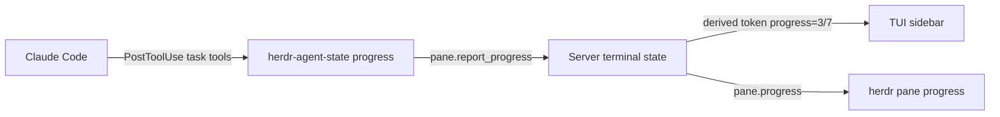

# #1 Agent progress checklist per pane

Fork-only work (`erodriiguezz/herdr`). Upstream PRs are not possible (not a maintainer or approved contributor). Issues are disabled on the fork, so this is numbered locally.

## 1. Approval summary

**What:** When Claude Code works through a task list, that pane's sidebar row shows the done/total count (for example `3/7`), and `herdr pane progress <pane>` prints the steps with ✓/▸/☐ marks. Both update as Claude ticks off steps, and clear when the agent session ends or changes.

**Why:** No visibility into how far along an agent is without opening its pane. It is small and low risk, and the checklist popup can build on the server-side path it adds.

**How:** Herdr stores the checklist in server state behind a new `pane.report_progress` method. The Claude integration adds a hook limited to the task-list tools that reports each change, and the server derives a `progress` display value into the sidebar data that already reaches the client. Turned down: a hook-only display value via `pane.report_metadata`, which gives a count but no checklist and nothing to query.

**Blast radius**
- Touches: terminal server state (new in-memory field), API schema (2 new methods), CLI (`herdr pane progress`), the Claude integration assets (`.sh` and `.ps1`) and the hook installer, the default agent sidebar row, and the `docs/next` website docs.
- Also affected: everyone with the Claude integration installed gets a re-install prompt (integration version bump) and one extra short hook process per task-list update, never per keystroke or render.
- Left alone: wire codecs and `PROTOCOL_VERSION` (the count travels in the existing `tokens` list), saved session state, agent detection manifests, the other 18 integrations, and render-loop cost (the display value is computed when a report arrives, not per frame).
- Rollback: revert the commit and re-install the integration; nothing is saved to disk, so there is no data to migrate.

**Concerns:**
- Upstream deliberately made Claude hooks session-only (`295b09ca`). Re-adding a per-tool hook diverges the fork from upstream, accepted on purpose. The matcher limits it to the task-list tools.
- Not verified yet: which task tools Claude Code 2.1.302 uses (`TodoWrite` sends the full list; newer `TaskCreate`/`TaskUpdate` may send one change at a time). The builder captures the real hook payload first. If it is not a full list, the builder stops and writes a Hand-off with the payload instead of guessing at a merge design.
- Committing `.claude/plans/` and `.claude/project.json` to the fork's master adds files upstream doesn't have. Accepted.

**Security**
- Data in and out: task titles and statuses from the local Claude hook into the herdr server, then out through the API, CLI and sidebar.
- Who can access it: only the local user, through the existing same-user socket permissions; no new listener.
- Stored: in memory only, per terminal (one per pane), until the agent session changes, the agent exits, or herdr restarts.
- Abuse: a buggy or hostile local reporter could flood the server or inject terminal escapes into the sidebar. Control: at most 100 items of 500 chars each (larger reports are rejected with an error), control characters stripped before storing, and stale reports dropped by `seq` like the existing report methods.

**Acceptance criteria**
- **Report and read** (AC-1.1) — `pane.report_progress` with 7 items (3 completed) stores them; `pane.progress` and `herdr pane progress <pane>` return the same 7 items in order with ✓ for completed, ▸ for in progress and ☐ for pending, plus `done: 3, total: 7`.
- **Sidebar count** (AC-1.2) — with the default sidebar config, the pane's agent row shows `3/7`; a pane with no checklist shows nothing extra.
- **Updates replace** (AC-1.3) — a newer report replaces the list; a report with an older `seq` is ignored; an empty item list clears the checklist and the sidebar count.
- **Lifecycle** (AC-1.4) — the checklist clears when the pane's agent session id changes, when the agent exits, and does not survive a herdr restart.
- **Limits and sanitising** (AC-1.5) — more than 100 items or an item over 500 chars is rejected with an error and leaves the previous checklist unchanged; control and escape characters in item text never reach the sidebar or CLI output.
- **Unknown pane** (AC-1.6) — reporting or reading progress for a pane that doesn't exist returns the standard not-found error.
- **Claude end to end** (AC-1.7) — in a throwaway herdr session running Claude Code 2.1.302, asking Claude for a multi-step task makes the sidebar count appear and advance to `N/N`, and `herdr pane progress` matches Claude's own list. Recorded with the CLI version and the tool names seen.
- **Hook install** (AC-1.8) — installing the Claude integration adds exactly one task-list hook with the right matcher next to the SessionStart hook; re-installing doesn't duplicate it; the integration version is bumped once from the latest release tag; `.sh` and `.ps1` behave the same.

**How it will be proven:** unit tests on the terminal state model and `AppState::test_new()`, API and CLI tests, installer tests, `just check`, then a live smoke with a real Claude Code session through the `herdr-throwaway-repro` skill. Herdr is a TUI, so there are no browser tests.

**Size** M · ~350 counted lines (plus tests) · ~400k tokens · single PR

**Out of scope:** the checklist popup inside herdr (next PR), a `pane.progress_changed` event (`EventKind` may be reachable from a frozen codec, so it needs its own contract review), saving checklists across restarts, progress reporting from the other 18 agent integrations (they can call the method; wiring them is later).

**Context:** none. User-facing docs go in `docs/next/website`.

---

## 2. Grill

| # | Question | Answer |
| --- | --- | --- |
| 1 | How: server state vs hook-only display value? | Store progress in herdr (server state + API + CLI + sidebar count). |
| 2 | What: where is the checklist visible in PR 1? | Count in the sidebar, the full list via `herdr pane progress`; the popup is a separate PR. |
| 3 | Lifecycle? | Memory only, cleared on new agent session or agent exit. |
| 4 | Proof? | `just check`, unit/API/CLI tests, live smoke with real Claude Code 2.1.302. |
| — | Why now (assumed) | Wanted as a herdr feature in the fork; small and low risk. |
| — | Ticket system (detected) | Issues disabled on the fork → `none`, numbered locally. |

## 3. Design & architecture

### Approach
- **State (server, pure data):** add `progress: Option<AgentProgress>` to `TerminalState` (where herdr keeps agent metadata), where `AgentProgress { items: Vec<ProgressItem>, done: usize, total: usize, source, last_seq }` and `ProgressItem { text: String, status: ProgressStatus }`. `ProgressStatus` is `Pending | InProgress | Completed`, plus an `Unknown` fallback when deserializing. Cleared wherever the pane's agent session id changes or the agent is released. Not added to persistence.
- **API (shared runtime fact, neutral names):** `pane.report_progress { pane_id, source, agent?, seq?, items }` replaces the list (an empty list clears it) and reuses `metadata_tokens::accept_sequence` for staleness. `pane.progress { pane_id }` returns `{ items, done, total }`, or an empty result when nothing is set. Both are new advertised methods. No change to existing method shapes, so `tests/fixtures/endpoint-method-shapes-v1.json` stays untouched.
- **Display (no wire change):** when progress changes, the server sets a derived `progress` token (`"3/7"`) in the pane's token map, which already goes to the client as `tokens: Vec<(String, String)>`. While a checklist exists, the derived value takes precedence over a user-reported `progress` metadata token. The default agent sidebar row gains `Custom("progress")`, which renders nothing when it's absent. The value is computed once per report, never in render.
- **CLI:** `herdr pane progress <pane> [--json]` through the existing `cli_params!` projection pattern, printing `✓`/`▸`/`☐ text`.
- **Claude integration:** the installer adds a `PostToolUse` hook (matcher: the task-list tool names confirmed live) calling the hook script with action `progress`. The script maps `tool_input.todos[].{content,status}` to items and sends `pane.report_progress`. Make sure the `HOOK_REMOVALS` cleanup of legacy herdr `PostToolUse` hooks does not delete the new matcher hook. Change `.sh` and `.ps1` together, and bump `HERDR_INTEGRATION_VERSION` and the matching constant once relative to the latest release tag.

### Alternatives considered
| Option | Why not |
| --- | --- |
| Hook-only `pane.report_metadata` token `progress=3/7` | No checklist and nothing to query; fails the goal of a per-pane checklist. |
| Server tails the Claude transcript JSONL (path already known) | File I/O and parsing in the server for one agent's private format; brittle across Claude versions. |
| New field on the wire sidebar structs | Frozen codec contract: would need a new codec. The existing `tokens` list carries the count for free. |
| Screen detection of Claude's todo list | Evidence-based detection rule forbids matching incidental text; the visible list scrolls away. |

### Contract
| Method | Path / operation | Change | Breaking? |
| --- | --- | --- | --- |
| socket JSON API | `pane.report_progress` | new, advertised | No |
| socket JSON API | `pane.progress` | new, advertised | No |
| CLI | `herdr pane progress` | new subcommand | No |

### Impact set
| Consumer / area | Owner | How it's affected |
| --- | --- | --- |
| TUI sidebar default row | fork | Shows `N/M` when a checklist exists |
| Claude integration users | fork | Re-install prompt from the version bump |
| API schema / operations list / CLI bindings | fork | Two new methods registered |

### Decisions
Recorded here instead of an ADR file (`docs/context/` is local-only and gitignored): server-owned checklist, displayed through the existing tokens list.

## 4. Plan

### PR split
| # | Branch | Scope | Est. lines |
| --- | --- | --- | --- |
| 1 | feat/agent-progress-checklist | everything above | ~350 |

### Files to touch
Line numbers are from `master` at `143bf5fd` and are only a guide; the builder anchors on the named function or struct.

**State: the checklist lives on the terminal, next to the agent metadata**
- `src/terminal/progress.rs` (new, declared beside `mod metadata;` at `src/terminal/state.rs:14`): `AgentProgress`, `ProgressItem`, `ProgressStatus` (with an `Unknown` fallback), validation (100 items, 500 chars each), control-character stripping, the done/total count, and unit tests. Keeps `state.rs` (already ~6,000 lines) from growing.
- `src/terminal/state.rs`
  - `struct TerminalState` (~line 129): add `progress: Option<AgentProgress>` and `progress_report_sequences: HashMap<String, u64>` beside `metadata_tokens` / `metadata_report_sequences`.
  - `TerminalState::new` (~line 168): initialise both empty.
  - `set_persisted_agent_session` (~line 1436): clear `progress` when the agent session id changes.
  - `release_agent_with_mutation` (~line 1811), plus the agent-process-exit path that sets `recent_agent_process_exit`: clear `progress`.
  - Not added to any persistence snapshot, so `src/persist/` is untouched.

**API: two new methods**
- `src/api/schema/panes.rs`: `PaneReportProgressParams` and `PaneProgressParams` via `cli_params!`, placed after `PaneReportMetadataParams` (~line 461); `ProgressItem` / `ProgressStatus` schema types; the `pane.progress` result type.
- `src/api/schema.rs` (~line 126): register `PaneReportProgress => "pane.report_progress"` and `PaneProgress => "pane.progress"` after `PaneReportMetadata`.
- `src/api/schema/operations.rs` (~line 197): add both names to the pane operations list.
- `src/app/api.rs` (~line 1195): dispatch both variants beside `Method::PaneReportMetadata`.
- `src/app/api/panes.rs`: `handle_pane_report_progress` and `handle_pane_progress`, after `handle_pane_report_metadata` (~line 1701). They reuse its pane lookup, not-found error and `metadata_tokens::accept_sequence` staleness check.
- `docs/next/api/herdr-api.schema.json`: regenerate it with the project's schema recipe, not by hand.

**Display: the count reaches the sidebar through the existing tokens**
- `src/app/creation.rs`, `pane_info` (~line 361, `tokens: terminal.metadata_tokens.values()`): add the derived `progress` → `"done/total"` entry, which wins over a user `progress` token while a checklist exists. That value already flows to the TUI through `src/server/client_shell.rs` (~line 159), which doesn't change.
- `src/config/sidebar.rs`, `impl Default for AgentsSidebarConfig` (~line 441): add `AgentSidebarToken::Custom("progress".into())` to the second default row, next to `Agent`; update the defaults test (~line 490).

**CLI**
- `src/cli/pane.rs`: `progress` subcommand next to `report-metadata` (~lines 198, 409), with `--json`; text output uses ✓/▸/☐; plus a parser test near the `report-metadata` tests (~line 999).
- `src/cli/pane/bindings.rs`: map both new `Method` variants beside `PaneReportAgentSession` (~lines 427, 709).

**Claude integration**
- `src/integration/claude_settings.rs`, `install` (~line 65): after the `SessionStart` `ensure_command_hook`, add a `PostToolUse` hook with the task-tool matcher calling action `progress`. Make sure the `HOOK_REMOVALS` entry for `PostToolUse` (~line 27) only removes the legacy unmatched hook, not the new one. `uninstall` removes it too.
- `src/integration/assets/claude/herdr-agent-state.sh`: allow the `progress` action in the `case` (~line 15), handle `PostToolUse` in the Python block (~line 53), and send `pane.report_progress`. Bump `HERDR_INTEGRATION_VERSION` (line 6).
- `src/integration/assets/claude/herdr-agent-state.ps1`: the same changes, plus the version marker (line 5).
- `src/integration/mod.rs:52`: bump `CLAUDE_INTEGRATION_VERSION`. The fork has no tags, so the base is upstream's latest stable release: if its Claude version is 11, bump to 12; if it is lower, master already carries an unreleased bump and 11 stays.
- `src/integration/tests.rs`: installer tests (one hook, idempotent re-install, survives the legacy cleanup, uninstall removes it).
- `src/integration/assets/herdr-agent-state.test.ts`: a `progress` payload-mapping case.

**Docs (unreleased drafts only)**
- `docs/next/website/src/content/docs/cli-reference.mdx`, `## Panes` (~line 276, after `report-agent-session`): `herdr pane progress`.
- `docs/next/website/src/content/docs/socket-api.mdx`: add both methods to the Pane row (~line 106) and a short section near the session-report text (~line 677).
- `docs/next/website/src/content/docs/integrations.mdx`, `## Claude Code` (~line 104): what the new hook reports.
- `docs/next/website/src/content/docs/configuration.mdx`, the agent sidebar rows section: the `$progress` token.

**Not touched:** `src/protocol/wire.rs` and `PROTOCOL_VERSION`, `tests/fixtures/endpoint-method-shapes-v1.json`, `src/persist/`, `src/detect/manifests/`, `src/server/client_shell.rs`, other integrations' assets, `docs/next/CHANGELOG.md`, `README.md`, `skills/herdr/SKILL.md`, `docs/preview/`, `docs/versions/`.

### Context
none

### Tests to add
- AC-1.1 unit: report 7 items → `pane.progress` returns them in order with done/total
- AC-1.1 CLI: `herdr pane progress` output marks and `--json`
- AC-1.2 unit: derived `progress` token = `3/7`; absent when there's no checklist; default sidebar row includes it
- AC-1.3 unit: replace, stale `seq` ignored, empty list clears the checklist and the token
- AC-1.4 unit: cleared on agent session id change and on agent release
- AC-1.5 unit: 101 items rejected, 501-char item rejected, previous list kept; ESC/C0 stripped
- AC-1.6 API: unknown pane → not-found for both methods
- AC-1.8 installer: hook added once with matcher, idempotent on re-install, survives legacy `PostToolUse` cleanup; version bumped
- AC-1.8 hook script: `herdr-agent-state.test.ts` case for the `progress` action payload mapping
- AC-1.7 live smoke (manual, recorded in evidence): Claude Code 2.1.302 in a throwaway session

### Screens
None (TUI). The live smoke records the sidebar row with `herdr agent read`/pane capture.

## 5. Evidence

## 6. Retro
- What the plan got wrong:
- What slowed the work:
- Rule, skill or fixture that would have prevented it:

## 7. Hand-off

### Hand-off: Claude integration blocked (hook payload is deltas, not a full list)

Captured with Claude Code 2.1.303 (`claude -p` with `--tools "TaskCreate,TaskGet,TaskUpdate,TaskList"` and a throwaway `--settings` file whose `PostToolUse` hook appends stdin to a file). `TodoWrite` is not offered by this version (asking for it in `--tools` yields no such tool). Default `-p` mode offers none of the task tools; they only appear when named in `--tools` (interactive sessions not yet captured).

Common payload keys: `session_id, transcript_path, cwd, prompt_id, permission_mode, agent_type, effort, hook_event_name, tool_name, tool_input, tool_response, tool_use_id, duration_ms`.

| tool_name | tool_input | tool_response |
| --- | --- | --- |
| TaskCreate | `{"subject":"A","description":"Step A"}` | `{"task":{"id":"1","subject":"A"}}` |
| TaskUpdate | `{"taskId":"1","status":"completed"}` | `{"success":true,"taskId":"1","updatedFields":["status"],"statusChange":{"from":"pending","to":"completed"}}` |
| TaskUpdate | `{"taskId":"2","status":"in_progress"}` | same shape, `statusChange.to = in_progress` |
| TaskList | `{}` | `{"tasks":[{"id":"1","subject":"A","status":"completed","blockedBy":[]}, ...]}` (full list) |

Create and update arrive one change at a time. Only `TaskList` carries the whole list, and Claude calls it at its own discretion. Per the plan, the integration (hook script `.sh`/`.ps1`, `claude_settings.rs`, integration version bumps, installer tests, `herdr-agent-state.test.ts`) was NOT built. Options for the lead: (a) hook only `TaskList` (full list, but updates only when Claude lists), (b) the hook script keeps a per-session task map merged from TaskCreate/TaskUpdate (needs state file or server-side merge API), (c) a server-side delta API. Server, API, CLI, sidebar and docs parts are built.
